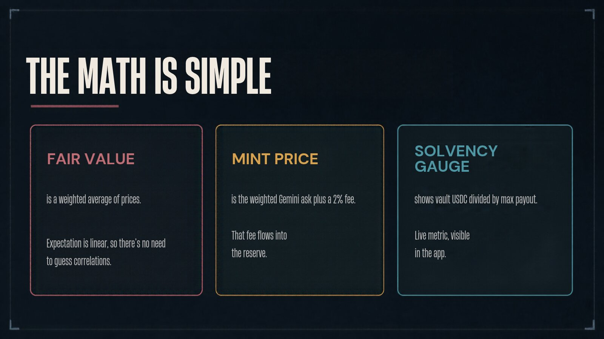

<p align="center">
  
</p>

<h3 align="center">Weave your worries into one hedge.</h3>

<p align="center">
  <a href="https://devpost.com/software/weave-vr5ci7">Devpost</a> ·
  <a href="https://explorer.testnet.arc.io/address/0xdab8e6446ea0819af35ed9ddf7fbc9a74d79e781?tab=contract">Verified contract on Arc</a> ·
  <a href="#run-it">Run it</a>
</p>

<p align="center">
  UBC 2026 Hackathon · DeFi &amp; Onchain Apps track · Best use of Arc · Gemini Prediction Markets bounty
</p>

---

Type a worry, and Weave builds one token from real Gemini prediction markets that pays out, leg by leg, if the bad things happen.
You buy it with USDC on Arc and redeem it once Gemini resolves the markets.

## Why

Every multi-leg prediction market product today is a combo (a parlay): if one leg misses, you get nothing.
That is the opposite of what a hedge should do.
A Weave basket pays per leg, so if 2 of your 3 worries happen, you get 2/3 of the payout.

| | Combo / parlay | Weave basket |
|---|---|---|
| Pays when | Every leg hits | Each leg that hits, by its weight |
| BTC drops, ETH doesn't (70/30 basket) | $0.00 | $0.70 per token |
| Price needs | Joint probability of all legs (a correlation model) | Each leg's own price |
| Backed by | The exchange | $1.00 of USDC per token, onchain |

## How it works

<p align="center">
  
</p>

1. **Worry to basket.** A basket is a set of Gemini markets (legs) with weights that sum to 100%. The demo basket, **Crash Cover**, holds NO on "BTC ≥ $X" (70%) and NO on "ETH ≥ $Y" (30%), with each strike just below the current price, in Gemini's hourly markets.
2. **Price.** The fair value of one token is Σ wᵢ·pᵢ. That holds whatever the correlation between legs, by linearity of expectation, so it needs no correlation model. The operator posts the mint price Σ wᵢ·askᵢ × 1.02 (a 2% fee). The contract refuses a mint when the price is older than 240 s or exceeds the buyer's max cost.
3. **Buy.** The user pays USDC on Arc and receives ERC-1155 basket tokens. Each token pays up to $1.
4. **Resolve.** After Gemini settles each market, the operator posts `resolveLeg` with Gemini's `resolutionSide` and `resolvedAt` as evidence. Each leg is resolved exactly once.
5. **Redeem.** Each token pays Σ wᵢ over the legs that hit, pro-rata: if BTC drops through its strike but ETH does not, a token pays $0.70.

### Architecture

```
 Gemini Prediction Markets (production, public API)
   │  live books, hourly BTC/ETH strike ladders, resolutionSide
   ▼
 Operator (contracts/operator)                         Gemini SANDBOX
   ├─ opens the hourly Crash Cover basket ──────────►  mirrors each mint:
   ├─ posts price = Σ wᵢ·askᵢ × 1.02 every 15 s        buys wᵢ·N NO contracts
   └─ posts each leg's result with evidence            per leg (never real money)
   ▼
 WeaveBasket (Arc testnet, ERC-1155 + USDC vault)
   mint(id, n, maxCost) · resolveLeg(id, leg, hit, evidence) · redeem(id, n)
   ▲
 Web app (web/, Next.js + viem + MetaMask)
   live prices via /api/live · buy · redeem · send
   AI builder via /api/build: LLM on Groq picks legs from the Gemini market list,
   output validated (known ids, weights sum to 1, honest "none"), rules fallback
```

## Economic design

- **Fully collateralized.** A mint is refused unless the vault holds at least $1 for every token outstanding (`reserve ≥ supply × $1`), so the reserve can always pay the maximum payout. The operator funds the gap between the price paid and $1 when it opens a basket. `solvencyBps(id)` exposes the coverage ratio and drives the app's solvency gauge.
- **Exact replication.** Because the payout is linear in the legs, the operator hedges a mint of N tokens by buying wᵢ·N contracts of each leg. The hedge runs on the Gemini sandbox in this build. A failed hedge never blocks a mint: the onchain reserve, not the hedge, backs payouts.
- **Revenue.** The 2% fee on the mint price. After settlement, `sweep` returns only the collateral that holders are not owed.
- **Why not a combo?** A combo pays only if every leg hits, so its price depends on the joint probability of all legs. A basket pays per leg, which is how a hedge should behave, and its price needs only each leg's own probability.

## Risk assumptions

| Risk | What it means | Mitigation in this build |
|---|---|---|
| Operator trust | The operator posts prices and results. | One-shot results with onchain evidence strings, a price staleness check, buyer max-cost slippage guard, full collateral. Signed quotes or an oracle come next. |
| Basis risk | A market's wording may not match the user's real exposure. | The builder shows each market's exact rule and source, and says when nothing fits. |
| Liquidity | Hedge-relevant markets can be thin. | Legs with no ask cannot be priced or bought; legs with no bid are flagged as illiquid. |
| Hedge failure | A sandbox order may not fill. | Recorded as unhedged; payouts are still fully backed by the reserve. |
| Testnet only | No real money anywhere. | Arc testnet USDC and the Gemini sandbox only. |

## Contracts (Arc testnet, chain 5042002)

| Contract | Address |
|---|---|
| WeaveBasket (ERC-1155 vault, [source verified](https://explorer.testnet.arc.io/address/0xdab8e6446ea0819af35ed9ddf7fbc9a74d79e781?tab=contract)) | [`0xdab8e6446ea0819af35ed9ddf7fbc9a74d79e781`](https://explorer.testnet.arc.io/address/0xdab8e6446ea0819af35ed9ddf7fbc9a74d79e781) |
| Operator | [`0x2dE880c145A3Fd99f6e122C24dC0bCF7f7189A89`](https://explorer.testnet.arc.io/address/0x2dE880c145A3Fd99f6e122C24dC0bCF7f7189A89) |
| USDC (Arc native, ERC-20 interface, 6 dp) | `0x3600000000000000000000000000000000000000` |

Baskets live now: Crash Cover rolls hourly (a new token id each hour); Recession Hedge is token id 3.

**Arc's role:** USDC is both the gas and the collateral, so a user only ever holds one asset. Every mint, resolution and redemption is an Arc transaction, and the vault's reserve is readable onchain at any time.

## Built with

Solidity · Hardhat · Arc testnet · Circle USDC · ERC-1155 · Gemini Prediction Markets API (production data, sandbox hedging) · Next.js 16 · React 19 · TypeScript · Tailwind CSS · viem · Groq

## Run it

```bash
# contracts: tests (12, including a solvency fuzz test)
cd contracts && npm install && npx hardhat test solidity

# deploy to Arc testnet (OPERATOR_KEY in the repo .env, funded at faucet.circle.com)
npx hardhat build && node --env-file=../.env scripts/deploy-arc.ts

# operator: opens hourly baskets, posts prices and results, hedges on the sandbox
node --env-file=../.env operator/operator.ts

# web app (set NEXT_PUBLIC_WEAVE_ADDRESS in web/.env.local; leave it empty for the mocked demo)
cd ../web && npm install && npm run dev
```

See `.env.example` and `web/.env.example` for every variable.
Local rehearsal without Arc: `npx hardhat node`, then `scripts/rehearse.ts`, which settles a basket against a Gemini market that has already resolved.

## Repo map

| Path | What it is |
|---|---|
| [`contracts/contracts/WeaveBasket.sol`](contracts/contracts/WeaveBasket.sol) | The vault and basket token |
| [`contracts/operator/`](contracts/operator) | Operator (pricing, basket lifecycle, resolution) and sandbox hedger |
| [`contracts/scripts/`](contracts/scripts) | Arc deploy, local chain and rehearsal scripts |
| [`web/`](web) | The Next.js app; `web/src/lib/gemini.ts` reads Gemini, `chain.ts` talks to Arc, `builder.ts` is the AI builder |
| [`docs/`](docs) | Design, screens, positioning and pitch notes |
| [`.planning/`](.planning) | Requirements, roadmap, research and team decisions |

## What's next

- Sell back to the vault before expiry, so you don't have to hold to resolution.
- Rolling cover past the roughly two-week window Gemini's crypto expiries allow today.
- Signed price quotes or an oracle in place of posted prices.
- Lending against basket tokens, since they are standard ERC-1155s.
- More curated baskets, and a real launch through a registered partner such as Gemini's exchange.

## Team

Built by Ezekiel (contracts, operator, hedger) and Cayden (data, frontend, AI builder, pitch).
